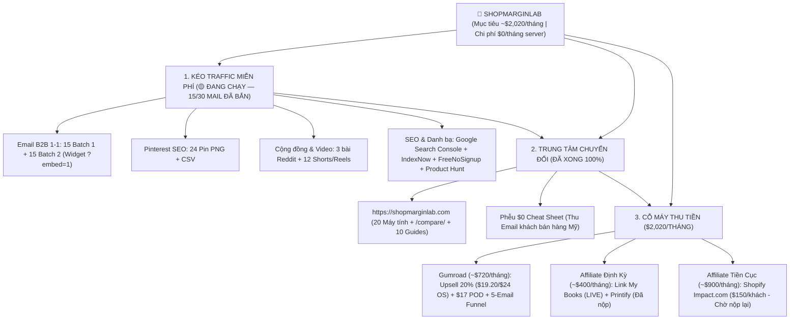

# 📊 ShopMarginLab (SML) — Master Dashboard, Mindmap & Milestones ($2,000/Tháng)

> **Cập nhật lần cuối:** `2026-11-27 21:26 (+07:00)` | **Live URL:** https://shopmarginlab.com/ | **Repo:** `ncthanh2809/shopmarginlab` (`master`)
> **Quy ước chuẩn:** Mỗi khi **Mr. Thanh** yêu cầu *"cập nhật"* cho **SML**, Aldric cập nhật trực tiếp file này và báo cáo đúng theo 4 phần: **Dashboard → Mindmap → Milestones → Step-by-Step**.

---

## 1. 🧭 Executive Dashboard (Trạng Thái Thực Tế Hiện Tại)

| Trụ cột | Hạng mục | Trạng thái | Ghi chú thực tế (Đã kiểm chứng) |
| :--- | :--- | :---: | :--- |
| **1. Web & SEO** | `https://shopmarginlab.com/` (45 routes, 20 tools, 10 guides) | ✅ **LIVE** | `45/45` HTTP 200, `www` → `301` apex, `robots.txt` & `sitemap.xml` (36 URL) chuẩn, IndexNow HTTP 200. |
| **1. Web & SEO** | Google Search Console + Cloudflare Analytics + `SML_KV` | ✅ **XONG** | Đã verify `sc-domain:shopmarginlab.com`, nộp sitemap 36 trang, KV đổi link trong 2 giây. |
| **2. Email & Domain** | Email Routing (`thanh@`, `founder@`, `support@shopmarginlab.com`) | ✅ **XONG** | Đã bật trên Cloudflare, chuyển tiếp thẳng về `digitalnomadstep@gmail.com`. |
| **2. Email & Domain** | DNS gửi đi (Brevo + Resend + SPF + DKIM + DMARC) | ✅ **XONG** | Đã nạp đủ DNS & verify domain trên Resend + Brevo. |
| **2. Email & Domain** | Gmail Send-As `thanh@shopmarginlab.com` | ✅ **ACCEPTED** | Đã xác minh thành công & gửi thật từ `Thanh Nguyen <thanh@shopmarginlab.com>`. |
| **3. Kiếm tiền** | Gumroad 3 sản phẩm (`$0` Cheat Sheet, `$24` OS, `$17` POD) | ✅ **LIVE** | Link chuẩn `shopmarginlab.gumroad.com/...` đã live trên web. Còn kiểm tra Upsell 20% & dán 5-Email Funnel. |
| **3. Kiếm tiền** | Affiliate #1: **Link My Books** (`$50 + 20%` trọn đời) | ✅ **ĐÃ DUYỆT & LIVE** | Đã gắn `linkmybooks.cello.so/mqa9XBXQElJ` lên web. Còn check email PayPal trên Cello. |
| **3. Kiếm tiền** | Affiliate #2: **Printify** (`5%` / 12 tháng) | ⏳ **ĐÃ NỘP ĐƠN** | Đã nộp 18:48 ngày 27/11 (`thanh@shopmarginlab.com`). Còn bấm `Create PartnerStack account` + chờ duyệt. |
| **3. Kiếm tiền** | Affiliate #3: **Shopify** (tới `$150`/đơn qua Impact.com) | ⏳ **CHỜ NỘP LẠI** | Trước bị reject do `.pages.dev`. Giờ đã có `.com`, cần đăng nhập Impact bằng `digitalnomadstep@gmail.com` để nộp lại. |
| **4. Kéo Traffic** | Email B2B Batch 1 (15 đối tác Mỹ) | ✅ **ĐÃ GỬI 15/15** | Đã gửi sạch từ `thanh@shopmarginlab.com` lúc 21:24–21:25 ngày 27/11 (`T003` done). Follow-up Ngày 4 hẹn 01/12 (`R005`). |
| **4. Kéo Traffic** | Email B2B Batch 2 (15 đối tác) | 📦 **SẴN SÀNG** | Đã soạn đủ tại `outreach/verified-campaigns.md`. Chờ gửi tối 28/11 lúc 20:15 (`T004` / `R004`). |
| **4. Kéo Traffic** | Pinterest Business (24 Pin PNG + Bulk CSV) | ⏳ **0/24 ĐÃ ĐĂNG** | Đã claim & verify `shopmarginlab.com`. App API v5 chờ submit reCAPTCHA (hoặc đăng tay luôn 4–5 pin/ngày). |
| **4. Kéo Traffic** | Reddit (3 bài) + 12 Kịch bản Video + Danh bạ Web | 📦 **SẴN SÀNG** | GitHub Awesome-lists đã nộp 3/3. Còn copy-paste `FreeNoSignup`, Reddit (`v3.3-acquisition-pack.md`) & quay video. |

---

## 2. 🧠 Sơ Đồ Mindmap Hệ Thống SML ($2,000/Tháng)

---

## 3. 🏁 Bảng Milestones (M0 → M4)

| Milestone | Thời gian | Tiến độ | Mục tiêu & Tiêu chí hoàn thành (KPI) | Ai làm? |
| :--- | :--- | :---: | :--- | :--- |
| **M0: Dựng Sản Phẩm & Web v3.3** | 25–26/11 | **✅ 100%** | 20 máy tính, `/compare/`, 10 guides, 3 file `.xlsx` live trên Gumroad, 24 pins PNG, 30 leads B2B, 3 PR GitHub. | Agent + Mr. Thanh |
| **M1: Hạ Tầng `.com` & Sẵn Sàng Bắn** | 27/11 | **✅ 100%** | Live `shopmarginlab.com` (45/45), `SML_KV`, GSC, Pinterest verify, Email Routing + Brevo/Resend DNS, Send-As `thanh@shopmarginlab.com` accepted, Link My Books LIVE, Printify đã nộp. | Agent + Mr. Thanh |
| **M2: Kích Hoạt Traffic Đợt 1** | 27/11 → 03/12 | **🟡 ~20%** | ✅ **Đã gửi 15/15 email Batch 1** (`27/11`). Tiếp theo: Cello PayPal & Gumroad Funnel (**Bước 2**), gửi 15 mail Batch 2 (**Bước 3**), đăng Pin/Reddit/FreeNoSignup (**Bước 4**), Follow-up + Video (**Bước 5**). **KPI:** 500–1,000 lượt truy cập + opt-in/đơn đầu tiên. | Mr. Thanh + Agent |
| **M3: Mở Khóa Shopify & Backlink DR Cao** | 04/12 → 10/12 | **⬜ Kế hoạch** | Nộp lại **Shopify Affiliate (Impact.com)** bằng `shopmarginlab.com`; rà GSC/Cloudflare Analytics; nộp **Product Hunt** & **AlternativeTo** (`T008`/`R009`). | Mr. Thanh + Agent |
| **M4: Tối Ưu & Cán Mốc $2,000/Tháng** | Tháng 2+ | **⬜ Kế hoạch** | Nhân bản thêm 5–10 máy tính theo từ khóa có impression cao nhất trên GSC; mở rộng B2B embed (`?embed=1`) lên 100+ blog/podcast; ghép doanh thu Shopify + Link My Books + Printify + Gumroad chạm **$2,000/tháng**. | Agent + Mr. Thanh |

---

## 4. ✅ Step-by-Step Chống Rối (CHỈ LÀM ĐÚNG TỪNG BƯỚC THEO THỨ TỰ)

> **Nguyên tắc vàng để không bị ngợp:** Đừng nhìn sang Bước 3 hay việc của tuần sau. Anh chỉ cần làm xong **Bước hiện tại**, gạch đi, rồi mới sang bước kế tiếp.

### 🔹 BƯỚC 1 — ~~Hôm nay 27/11~~ (**✅ ĐÃ HOÀN THÀNH lúc 21:25**)
1. ~~Xác minh `thanh@shopmarginlab.com`~~ (**Accepted**).
2. ~~Gửi 15 Drafts Batch 1 (`T003`)~~ (**Đã gửi 15/15** từ `Thanh Nguyen <thanh@shopmarginlab.com>` lúc 21:24–21:25 VN; Follow-up Ngày 4 hẹn 01/12).

### 🔹 BƯỚC 2 — Sáng mai 28/11 lúc 09:00 (`R010` · 10 phút · Khóa cổng nhận tiền `T002`) — **VIỆC TIẾP THEO**
1. Đăng nhập **Cello (Link My Books)** → kiểm tra mục Payout đã điền đúng **PayPal** của anh chưa.
2. Đăng nhập **Gumroad** → vào sản phẩm `$0` (`free-2026-fee-cheat-sheet`) kiểm tra đã bật **Upsell giảm 20%** sang gói `$24`, và dán **5 Email Funnel** trong [social-distribution-pack.md](file:///C:/Users/Admin/.gemini/antigravity/scratch/shopmarginlab/growth/social-distribution-pack.md) vào **Gumroad Workflows**. *(Xong nhắn: `"xong Bước 2"`).*

### 🔹 BƯỚC 3 — Tối mai 28/11 lúc 20:15 (15 phút · `T004`)
1. Báo Aldric đẩy **15 email Batch 2** vào Drafts (hoặc copy từ [verified-campaigns.md](file:///C:/Users/Admin/.gemini/antigravity/scratch/shopmarginlab/outreach/verified-campaigns.md)) → bấm gửi.
2. Vào `https://freenosignup.com/` bấm **Submit Tool**, copy-paste sẵn từ [v3.3-acquisition-pack.md](file:///C:/Users/Admin/.gemini/antigravity/scratch/shopmarginlab/growth/v3.3-acquisition-pack.md).

### 🔹 BƯỚC 4 — Ngày 29–30/11 (15 phút/ngày · `T005`)
1. **Pinterest (Không cần đợi App API v5):** Mở Pinterest Business → đăng tay **4–5 Pin/ngày** từ thư mục `products/dist/pins-png/` + copy mô tả từ [pinterest-seo-descriptions.md](file:///C:/Users/Admin/.gemini/antigravity/scratch/shopmarginlab/products/dist/pinterest-seo-descriptions.md).
2. **Reddit:** Copy-paste 3 bài trong [v3.3-acquisition-pack.md](file:///C:/Users/Admin/.gemini/antigravity/scratch/shopmarginlab/growth/v3.3-acquisition-pack.md) lên `r/Depop`, `r/TikTokShopSellers`, `r/EtsySellers` *(nhớ comment giúp 2–3 bài khác trước khi đăng)*.

### 🔹 BƯỚC 5 — Ngày 01–03/12 (`R005` & `T006`)
1. Gửi **Follow-up Ngày 4** cho 15 người Batch 1 (nội dung có sẵn trong [verified-campaigns.md](file:///C:/Users/Admin/.gemini/antigravity/scratch/shopmarginlab/outreach/verified-campaigns.md)).
2. Quay màn hình **2–3 video 30 giây** theo Script 1 & 2 trong [v3.3-acquisition-pack.md](file:///C:/Users/Admin/.gemini/antigravity/scratch/shopmarginlab/growth/v3.3-acquisition-pack.md), đăng lên TikTok / YouTube Shorts / Reels.

### 🔹 BƯỚC 6 — Khi rảnh trên máy tính (`T001` & `T008` — M3)
1. Bấm nút **`Create your PartnerStack account`** trong email Printify (để theo dõi duyệt Printify & gắn PayPal).
2. Đăng nhập **Impact.com** bằng `digitalnomadstep@gmail.com` để nộp lại **Shopify Affiliate** với `https://shopmarginlab.com/shopify-vs-etsy-calculator/`.
3. Ngày **10/12**: Rà traffic trên GSC/Cloudflare Analytics → nộp **Product Hunt** & **AlternativeTo**.
